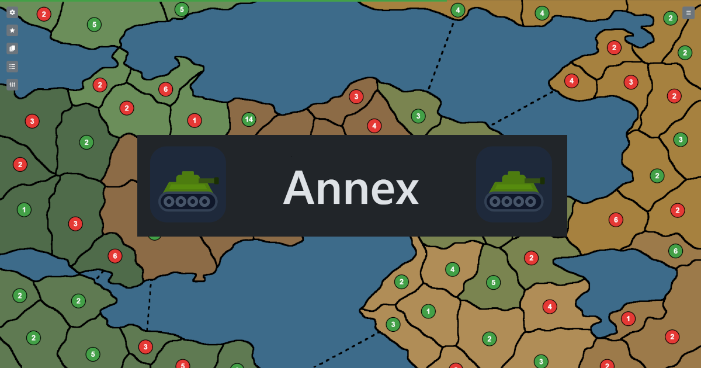

<div align="center">


# annex

**A free, open source strategy game of conquest.**

Claim territories, grow your armies and outplay your rivals.

[](https://www.annexgame.com)
[](LICENSE)



</div>

<br>

> **annex** /ænˈeks/ *(verb)*: to take possession of an area of land or a country, usually by force or without permission

<br>

## What is Annex?

You and your rivals, humans or bots, fight over a map of territories, and the last commander standing wins.

| | |
|---|---|
| 🌍 **Play online** | Battle friends and strangers in real time, with ranks and Elo. |
| 🤖 **Play offline** | Practice against bots of different difficulties and personalities, no account needed. |
| 🗺️ **Draw your own maps** | Build maps in the in-app editor, generate them procedurally, and challenge the community to fight over them. |
| 🎓 **Learn in minutes** | Short hands-on tutorials teach deploying, attacking, cards, capitals, fog of war, naval combat and more. |

**Free. Open source. Forever.** No ads, no microtransactions, now or ever.

<br>

## Contributing

Annex is built by a small team and we need more hands. Whether you want to help once or stay for the long run, you are very welcome.

We are looking for people who love:

- 💻 **Coding and software engineering**
- 🎨 **Art, animation and graphic design**
- 🎵 **Sound design and music**
- 📣 **Marketing, PR and social media**

Not sure where to start? Play a few games, find something that could be better, and open an issue or a pull request. Feedback, maps and ideas shape where the game goes next.

Before you change anything, read [CLAUDE.md](CLAUDE.md) for the project conventions, and [PROTOCOL.md](PROTOCOL.md) for the events and types shared between the server and the client.

<br>

## How it is built

The repository is an npm workspace with three modules:

| Module | What lives there | Tech |
|---|---|---|
| [`engine`](engine) | Game rules, bot AI and map generation. Pure logic, shared by the server and the client. | TypeScript |
| [`server`](server) | Accounts, lobbies, matchmaking, real-time games and storage. | Node.js, Express, Socket.io, MongoDB |
| [`client`](client) | The game UI, the map editor, replays and tutorials. | Vite, React, React-Bootstrap |

<br>

## Run it locally

**Requirements:** [Node.js](https://nodejs.org/en/download) and a local [MongoDB](https://www.mongodb.com/docs/manual/installation/) on the default port `27017`.

```bash
git clone https://github.com/GabrieleMaurina/annex.git
cd annex
npm i
npm run dev
```

This starts the server and the client together. Open the address Vite prints in the terminal and you are in.

<details>
<summary><b>Environment variables</b> (optional)</summary>

<br>

Set these for the server:

| Variable | Purpose |
|---|---|
| `MONGO_USER`, `MONGO_PASS` | MongoDB credentials. Omit both to connect without auth. |
| `SMTP_HOST`, `SMTP_PORT`, `SMTP_USER`, `SMTP_PASS`, `EMAIL_FROM` | SMTP settings. If they are not all set, no emails are sent. |

</details>

<details>
<summary><b>Run the server and client separately</b></summary>

<br>

```bash
cd server/
npm run dev
```

```bash
cd client/
npm run dev
```

</details>

<br>

## Spread the word

A strategy game is only as good as the people you can play it with. If you enjoy Annex, invite your friends, share your best conquests and custom maps, and tag us.

<div align="center">

[**Play**](https://www.annexgame.com) · [**X**](https://x.com/annexstrategy) · [**Instagram**](https://www.instagram.com/annexstrategygame) · [**TikTok**](https://www.tiktok.com/@annexgame) · [**YouTube**](https://www.youtube.com/channel/UCLbKo3d0IrDn6INuGLz55OA) · [**Discord**](https://discord.gg/2AyYzBrHZ) · [**itch.io**](https://annexgame.itch.io/annexgame) · [**GitHub**](https://github.com/GabrieleMaurina/annex)

<br>

Released under the [GNU General Public License v3.0](LICENSE).

</div>
